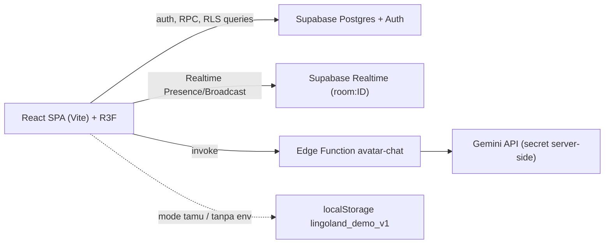
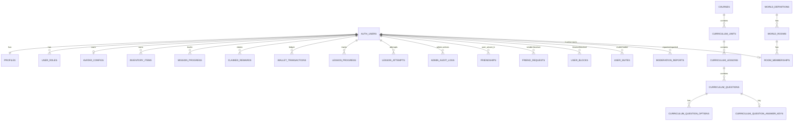

# Architecture & ERD

## Gambaran umum

- **Frontend:** React 18, React Router 6, Three.js via react-three-fiber/drei, Tailwind.
- **Backend:** Supabase (Auth, Postgres + RLS, RPC `security definer`, Realtime, Edge Function).
- **Mode demo/tamu:** tanpa `VITE_SUPABASE_*` atau akun tamu, semua fitur sosial disimulasikan lokal; tidak ada data ke server.

## Prinsip keamanan

- Operasi sensitif (koin, reward, grading, friend, join room, report) lewat **RPC security definer**; klien tidak menulis langsung ke tabel ekonomi.
- Kunci jawaban soal di tabel terpisah (`curriculum_question_answer_keys`), tidak terbaca learner.
- Role di `user_roles` (`user|moderator|admin`), dicek via `is_admin()` di RLS dan RPC.
- Posisi/gerakan **ephemeral** di Realtime Broadcast (tidak ditulis ke DB per frame).

## Peta rute

| Route | Halaman | Akses |
|---|---|---|
| `/`, `/login`, `/register`, `/forgot-password` | publik | — |
| `/app/home, learn, lessons, avatar, avatar-chat, store, topup, profile` | aplikasi | login |
| `/app/world` | Mini Home (latihan privat NPC) | login |
| `/app/plaza`, `/app/plaza/:roomId` | Social Plaza (multiplayer) | login + persetujuan pedoman |
| `/app/friends` | teman | login |
| `/admin` | dashboard admin | role admin |

## Modul realtime

- `src/lib/realtime/protocol.ts` — skema paket movement v1, throttle 10 Hz, `isSequenceFresher`, `clampMovement` (maks 4.0 unit/paket).
- `src/lib/realtime/roomService.ts` — RPC join/leave/heartbeat/create room.
- `src/hooks/useMultiplayerRoom.ts` — presence + broadcast posisi; timeout pemain remote 8 dtk.
- `src/hooks/useRoomChat.ts` — chat/undangan latihan via broadcast di channel room; rate limit 800 ms; filter mute/block.
- `src/lib/plazaWorld.ts` — collider, spawn, interaksi Plaza.

## ERD

Definisi kolom lengkap: lihat file di `supabase/migrations/` (sumber kebenaran skema).

## Batasan diketahui (arsitektur)

- Chat berjalan via Realtime Broadcast: **tidak dipersist** di DB dan tidak ada verifikasi pengirim di sisi server (pengirim dapat memalsukan `senderName` di payload broadcast). Ini diterima untuk MVP; mitigasi lanjutan: RPC/tabel pesan dengan RLS atau Edge Function.
- Daftar pemain Plaza berasal dari presence klien; kapasitas room ditegakkan saat `join_world_room` (server), bukan pada channel Realtime.
- Kapasitas 10–20 pemain/room adalah target eksperimen; belum ada load test terhadap Supabase Realtime sungguhan.
