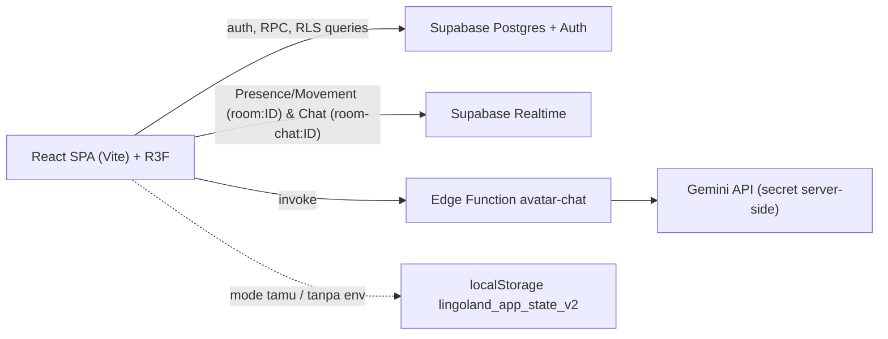
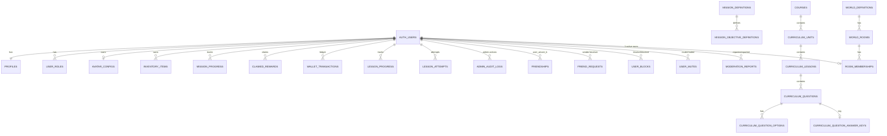

# Architecture & ERD

## Gambaran umum

- **Frontend:** React 18, React Router 6, Three.js via react-three-fiber/drei, Tailwind CSS.
- **Backend:** Supabase (Auth, Postgres + RLS, RPC `security definer`, Realtime, Edge Function).
- **Mode tamu:** tanpa `VITE_SUPABASE_*` atau tombol *Coba Mode Tamu (Lokal)*, semua fitur berjalan secara terisolasi di browser dan tidak menulis data ke server.

## Prinsip keamanan (Server-Authoritative)

- **Single Authoritative Lesson Grading:** Kelulusan lesson dan pemberian XP untuk akun autentikasi hanya dapat terjadi melalui `public.grade_lesson_attempt_atomic(p_lesson_unit_id, p_answers)`. Fungsi lama `complete_lesson_atomic` telah dicabut dan dihapus pada migrasi `20261103000010_fix_lesson_reward_security.sql`.
- **Perlindungan Tabel Progres & Ekonomi:** Learner hanya memiliki akses `SELECT` pada `lesson_progress`, `claimed_rewards`, `inventory_items`, `mission_progress`, `lesson_attempts`, dan `wallet_transactions` (`20261103000011_fix_lesson_progress_permissions.sql`). Sinkronisasi klien (`pushRemoteState`) hanya memperbarui metadata profil (`name`, `username`, `display_name`) dan `avatar_configs` yang tervalidasi kepemilikannya.
- **Verifikasi Objektif Misi Server-Side:** Klaim reward misi NPC (`claim_mission_reward_atomic`) memverifikasi bahwa seluruh objektif percakapan misi pada `mission_objective_definitions` telah diselesaikan melalui `verify_mission_objective_atomic` (`20261103000013_harden_mission_reward_validation.sql`).
- **Kunci Jawaban Rahasia:** Kunci jawaban soal disimpan di tabel `curriculum_question_answer_keys` yang hanya dapat diakses oleh admin/service_role dan dievaluasi di dalam `grade_lesson_attempt_atomic`.
- **RLS Multiplayer Bebas Rekursi & Penegakan Join:** Kebijakan `room_memberships` dan `world_rooms` menggunakan helper `SECURITY DEFINER STABLE` (`get_my_active_room_id()`, `is_public_active_room()`) untuk mencegah rekursi RLS, dan `join_world_room` mengunci baris room (`FOR UPDATE`) sebelum memeriksa kapasitas (`20261103000012_fix_room_membership_rls.sql`).

## Peta rute

| Route | Halaman | Akses |
|---|---|---|
| `/`, `/login`, `/register`, `/forgot-password` | publik | — |
| `/app/home, learn, lessons, avatar, avatar-chat, store, topup, profile` | aplikasi | login / tamu |
| `/app/world` | Mini Home (latihan privat NPC) | login / tamu |
| `/app/plaza`, `/app/plaza/:roomId` | Social Plaza (multiplayer) | login / tamu + persetujuan pedoman |
| `/app/friends` | teman | login / tamu |
| `/admin` | dashboard admin | role admin |

## Modul realtime

- `src/lib/realtime/protocol.ts` — skema paket movement v1, throttle 10 Hz, validasi kecocokan `roomId` & batas koordinat dunia `[-50, 50]`, `isSequenceFresher`, `clampMovement` (maks 4.0 unit/paket).
- `src/lib/realtime/roomService.ts` — RPC join/leave/heartbeat/create room.
- `src/hooks/useMultiplayerRoom.ts` — memeriksa hasil `joinWorldRoom` terlebih dahulu; jika ditolak (`ok === false`), tidak melakukan subscribe channel, presence, atau broadcast.
- `src/hooks/useRoomChat.ts` — channel terdedikasi `room-chat:<roomId>` dengan pembersihan `supabase.removeChannel` saat pindah room/unmount, pelacakan status pesan (`pending` | `sent` | `failed`), rate limit 800 ms, pencocokan identitas pengirim terhadap presence room, dan filter mute/block.
- `src/lib/plazaWorld.ts` — collider, spawn, interaksi Plaza.

## ERD

Definisi kolom lengkap: lihat file di `supabase/migrations/` (migrasi `000000`–`000013`) dan bundel `supabase/schema.sql`.

## Batasan diketahui (arsitektur)

- Chat berjalan via Supabase Realtime Broadcast (`room-chat:<roomId>`): identitas pengirim dicocokkan terhadap daftar presence room di sisi klien dan pesan disanitasi, namun pesan **tidak dipersist** ke tabel database.
- Kapasitas 10–20 pemain/room ditegakkan secara atomik saat `join_world_room` di database; beban 20 pemain telah diuji secara sintetis pada unit test dan siap untuk demonstrasi langsung 2–5 pemain nyata pada Supabase Free.
